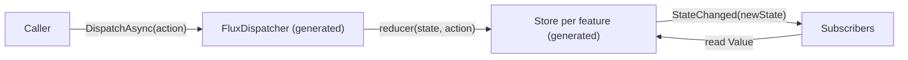

# Core Concepts

Flux keeps application state in stores that only change in one way: something dispatches an
action, and reducers compute the next state from the current state and that action.



ZeroAlloc.Flux has four building blocks you write, `[Feature]` state, actions, `[Reducer]` methods
and, if you need them, effects, and three things the generator writes for you: a store per
feature, one dispatcher, and the `AddZeroAllocFlux` registration method.

## State: features

A feature is one slice of state. Mark it with `[Feature]`:

```csharp
using ZeroAlloc.Flux;

[Feature]
public readonly partial record struct CartState(int ItemCount, decimal Total);
```

A feature type must be:

- **`partial`.** Otherwise the build fails with [ZFLUX005](diagnostics.md#zflux005).
- **Not generic**, and not nested in a generic type ([ZFLUX006](diagnostics.md#zflux006)).
- **`public` or `internal`**, as must every type that contains it
  ([ZFLUX007](diagnostics.md#zflux007)).
- **Creatable with `new TState()`**, unless it names an `InitialState` factory. A record struct
  always is; a record class needs a `public` or `internal` parameterless constructor
  ([ZFLUX009](diagnostics.md#zflux009)).

Treat the state as immutable: a reducer returns a new value instead of changing the old one.

### Record struct or record class

Both work. They differ in how the generated store keeps them:

| | `record struct` | `record class` |
|---|---|---|
| Allocation per update | none | the new state object your reducer creates |
| Write | runs the reducer under a lock | runs the reducer, then swaps the reference with a compare-and-swap, retrying on conflict |
| Read | lock-free; retries if it races a write, so it never returns half of a state | lock-free; reads one reference |
| Default initial state | `new TState()`, always available | `new TState()`, so the type needs a parameterless constructor, or an `InitialState` factory |

Prefer a `readonly record struct`. It is the shape the 0 B budgets in [Performance](performance.md)
are measured with.

### Initial state

Without anything else, a store starts from `new TState()`. A record class with only a primary
constructor has no parameterless constructor, which reports
[ZFLUX009](diagnostics.md#zflux009), so give it one:

```csharp
[Feature]
public sealed partial record SettingsState(string Theme)
{
    public SettingsState() : this("light") { }
}
```

When the initial state comes from configuration or another service, name a factory with
`InitialState`. The factory must be `public static`, take an `IServiceProvider` and return the
feature type ([ZFLUX004](diagnostics.md#zflux004)):

```csharp
using Microsoft.Extensions.DependencyInjection;
using ZeroAlloc.Flux;

[Feature(InitialState = nameof(Create))]
public readonly partial record struct PageSizeState(int PageSize)
{
    public static PageSizeState Create(IServiceProvider services)
        => new(services.GetRequiredService<AppOptions>().DefaultPageSize);
}

public sealed class AppOptions
{
    public int DefaultPageSize { get; init; } = 25;
}
```

The store calls the factory once, when the container creates it.

## Actions

An action is any type: it needs no base class and no marker interface. A `readonly record struct`
is a good fit, because the dispatcher passes it along without copying or boxing it:

```csharp
public readonly record struct AddItemAction(decimal Price);
public readonly record struct ClearCartAction;
```

The generator learns the action types from the second parameter of each reducer. An action that no
reducer handles is ignored: dispatching it does nothing and completes at once.

## Reducers

A reducer is a `public static` method marked `[Reducer]`. Its first parameter is the feature state,
its second is the action, and it returns the new state:

```csharp
public static class CartReducers
{
    [Reducer]
    public static CartState On(CartState state, AddItemAction action)
        => state with { ItemCount = state.ItemCount + 1, Total = state.Total + action.Price };

    [Reducer]
    public static CartState On(CartState state, ClearCartAction _) => new(0, 0m);
}
```

The rules:

- The method is `public static`, and its return type is its first parameter's type
  ([ZFLUX003](diagnostics.md#zflux003)).
- The state parameter's type is a `[Feature]` ([ZFLUX001](diagnostics.md#zflux001)).
- It takes exactly two parameters, the state and the action, neither `ref` nor `out`. The
  dispatcher calls it with those two, so any other parameter list reports
  [ZFLUX003](diagnostics.md#zflux003).
- One class may hold at most one reducer per state and action pair
  ([ZFLUX002](diagnostics.md#zflux002)).
- The class holding reducers can be any class; it does not need to be `partial` or `static`.

### Reducers must be pure

A reducer computes the next state from its two arguments and nothing else. Do not call services,
do I/O or dispatch from a reducer, for two reasons:

- For a record class feature, the store retries a reducer when another thread updated the state
  first, so the reducer can run more than once for one dispatch.
- For a record struct feature, the reducer runs while the store holds its lock.

Work that has side effects belongs in an [effect](#effects).

### One action, several features

Several features can react to the same action. Each has its own reducer, and one dispatch updates
all of them:

```csharp
[Feature]
public readonly partial record struct BadgeState(int Count);

public static class BadgeReducers
{
    [Reducer]
    public static BadgeState On(BadgeState state, AddItemAction _)
        => state with { Count = state.Count + 1 };
}
```

Dispatching `AddItemAction` now updates `CartState` and then `BadgeState`. Each store raises its own
`StateChanged` after its own update.

## Stores

The generator emits one store per feature and registers it as `IStore<TState>`:

```csharp
public interface IStore<TState>
{
    TState Value { get; }
    event Action<TState> StateChanged;
}
```

- **`Value`** is the current state. Reading it is lock-free, does not allocate, and is safe from
  any thread while other threads dispatch. A read always returns a state a reducer stored, never a
  mix of two.
- **`StateChanged`** fires after each update, with the new state. Handlers run synchronously on the
  thread that dispatched, after the store has released its lock, and the dispatch completes when
  they return. Keep handlers short; move long-running work off the dispatching thread.

The store has no public method to change the state. The only way to change it is to dispatch an
action.

```csharp
var cart = provider.GetRequiredService<IStore<CartState>>();
cart.StateChanged += state => Console.WriteLine($"{state.ItemCount} items, {state.Total:C}");
Console.WriteLine(cart.Value.ItemCount);
```

## The generated dispatcher

`IDispatcher` has a single method:

```csharp
public interface IDispatcher
{
    ValueTask DispatchAsync<TAction>(TAction action);
}
```

The generator implements it as an `internal sealed class FluxDispatcher` in the
`ZeroAlloc.Flux.Generated` namespace. For the cart example above it emits, slightly abridged:

```csharp
internal sealed class FluxDispatcher : IDispatcher
{
    // One overload per action type. One feature: call its store directly.
    public ValueTask DispatchAsync(ClearCartAction action)
    {
        var store_CartState = (Store_CartState)_sp.GetRequiredService<IStore<CartState>>();
        return store_CartState.UpdateAsync(action, static (s, a) => CartReducers.On(s, a));
    }

    // Several features: update each store in turn.
    public ValueTask DispatchAsync(AddItemAction action) { /* CartState, then BadgeState */ }

    // The interface method picks the overload by the static type of TAction.
    public ValueTask DispatchAsync<TAction>(TAction action)
    {
        if (typeof(TAction) == typeof(AddItemAction))
            return DispatchAsync(Unsafe.As<TAction, AddItemAction>(ref action));
        if (typeof(TAction) == typeof(ClearCartAction))
            return DispatchAsync(Unsafe.As<TAction, ClearCartAction>(ref action));
        return ValueTask.CompletedTask;
    }
}
```

What that means for you:

- **No lookup at run time.** For a struct action, the JIT reduces the `typeof` chain to a direct
  call to the matching overload.
- **The static type picks the reducers.** `DispatchAsync<TAction>` matches on the compile-time
  type of the argument. Dispatching an action through a variable typed `object` or an interface
  matches no reducer and does nothing. Dispatch the concrete action type.
- **The `ValueTask` completes synchronously.** The generated stores run reducers and handlers
  synchronously, so `DispatchAsync` has finished all its work when it returns. You can still
  `await` it like any `ValueTask`.

### Generated files

| File | Contents |
|---|---|
| `<Namespace>.<Feature>.Store.g.cs` | The store for one feature, an `internal sealed class` named `Store_` followed by the namespace and feature name, such as `Store_MyApp_CartState` |
| `FluxDispatcher.g.cs` | `internal sealed class FluxDispatcher : IDispatcher` |
| `FluxServiceCollectionExtensions.g.cs` | `public static class FluxServiceCollectionExtensions` with `AddZeroAllocFlux` |

All three are in the `ZeroAlloc.Flux.Generated` namespace. To read them, set
`<EmitCompilerGeneratedFiles>true</EmitCompilerGeneratedFiles>` in your project and look under
`obj/`.

### Registration

`AddZeroAllocFlux(this IServiceCollection services, ServiceLifetime lifetime = ServiceLifetime.Scoped)`
registers `FluxDispatcher` as `IDispatcher` and each store as its `IStore<TState>`, all with the
lifetime you pass. The dispatcher resolves stores from the same provider it was created from, so a
scoped dispatcher updates the stores of its own scope.

## Effects

ZeroAlloc.Flux 1.x has no effects package. An effect is work with side effects, such as an HTTP
call, that runs because of an action and dispatches its outcome as more actions. Write it as an
ordinary service that injects `IDispatcher`:

```csharp
[Feature]
public readonly partial record struct WeatherState(bool Loading, string? Forecast, string? Error);

public readonly record struct LoadWeatherAction(string City);
public readonly record struct WeatherLoadedAction(string Forecast);
public readonly record struct WeatherFailedAction(string Error);

public static class WeatherReducers
{
    [Reducer]
    public static WeatherState On(WeatherState state, LoadWeatherAction _)
        => state with { Loading = true, Error = null };

    [Reducer]
    public static WeatherState On(WeatherState state, WeatherLoadedAction action)
        => new(Loading: false, action.Forecast, Error: null);

    [Reducer]
    public static WeatherState On(WeatherState state, WeatherFailedAction action)
        => state with { Loading = false, Error = action.Error };
}

public interface IWeatherClient
{
    Task<string> GetForecastAsync(string city, CancellationToken cancellationToken);
}

public sealed class WeatherEffects(IDispatcher dispatcher, IWeatherClient client)
{
    public async Task LoadAsync(string city, CancellationToken cancellationToken)
    {
        await dispatcher.DispatchAsync(new LoadWeatherAction(city));
        try
        {
            var forecast = await client.GetForecastAsync(city, cancellationToken);
            await dispatcher.DispatchAsync(new WeatherLoadedAction(forecast));
        }
        catch (HttpRequestException ex)
        {
            await dispatcher.DispatchAsync(new WeatherFailedAction(ex.Message));
        }
    }
}
```

Register the effect with the same lifetime as Flux, so it dispatches into the same stores that
your components read:

```csharp
services.AddZeroAllocFlux();
services.AddScoped<WeatherEffects>();
```

The reducers stay pure: they only record that loading started, succeeded or failed. The effect
owns the I/O, the cancellation and the error handling.
